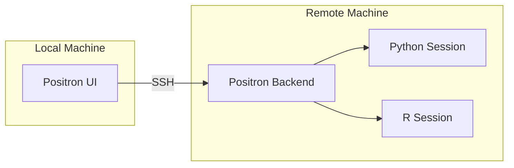
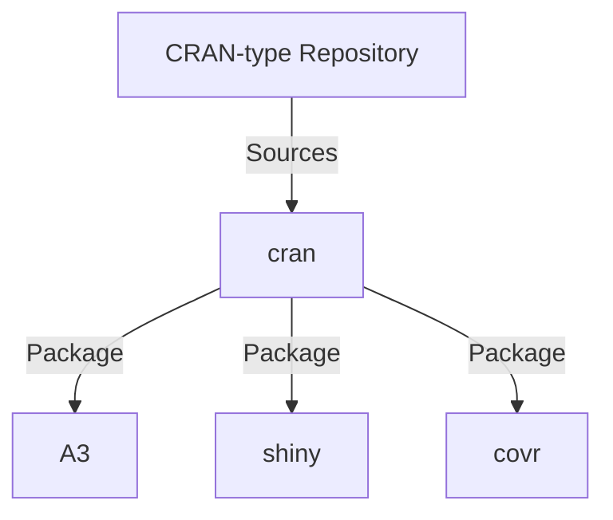

# Posit Documentation Theme Example

## Level two

Some text for level two.

[Test link](https://docs.posit.co)

### Level three

Some text for level three and showing `inline-code` references.

### Another level three

Here is a footnote reference,[^1] and another.

#### Level four

Four levels deep. How far can we go?

##### Level five

Five is jive.

###### Level six

Six is deep enough! Stop!

## Level two: coding

``` r
cat("cats are cats\n")
```

``` python
# Comment
print("snakes are not cats")
```

``` txt
Checking Job Launcher configuration...
Ensuring server-user is a Job Launcher admin...
Getting list of Job Launcher clusters...
Job launcher configured with the following clusters: Kubernetes, Local
launcher-adhoc-clusters is empty - all clusters may be used to launch adhoc jobs
launcher-sessions-clusters is empty - all clusters may be used to launch session jobs
Waiting for job to finish...
Job has finished running
Job exited successfully
```

``` default
The default language identifier; used sometimes for logs.
```

And now for a code block without any language identifier.

    This is some text in a code block without a language tag.

### Tabsets and pills

## RHEL

``` bash
$ yum install rstudio-workbench-rhel
```

## Ubuntu \| Debian

``` bash
$ dpkg
```

## Ubuntu 22.04

``` bash
$ You can nest tabsets
```

## Ubuntu 20.04

``` bash
$ Nesting
```

## SUSE

``` bash
$ zypper
```

## Pills

You can use tabs and pills for text, code blocks, tables, etc.

## Code

A single code block

``` bash
$ yum install rstudio-workbench-rhel
```

Nested pills

## RHEL

``` bash
$ yum install rstudio-workbench-rhel
```

## Ubuntu \| Debian

``` bash
$ dpkg
```

## SUSE

``` bash
$ zypper
```

## Table

|       |                           |
|-------|---------------------------|
| Table | some text about the table |
| Row   | More stuff                |

## Image

Example of an [informative image](https://www.w3.org/WAI/tutorials/images/informative/), with relevant alt text: 

Example of a [decorative image](https://www.w3.org/WAI/tutorials/images/decorative/), with empty alt text: 

## Level two: callouts

Code-first means using code first. Does that mean we never do things manually? No. Hands-on is delightful.

> **NOTE:**
>
> This is a note.

> **WARNING:**
>
> Explains hazards that could damage a product, including data loss.

> **IMPORTANT:**
>
> This is important; don’t ignore this information.

> **NOTE:**
>
> This is a collapsed note.

> **NOTE:**
>
> This is a note with an alternate title.

> **NOTE:**
>
> This is a simple note.

> **IMPORTANT:**
>
> This is a simple note.

> **WARNING:**
>
> This is a simple note.

## Level two: lists

### Unordered list

#### Compact

- ant
  - bear
  - cat
  - dog
- elephant
  - frog
  - giraffe
    - hyena
    - iguana
  - jaguar
- kangaroo
- lion
- mouse

#### Spaced

- This is some text that is presented as a spaced list.

  This type of list is a good fit when there are multiple paragraphs or complicated elements which span multiple lines.

- It is also good for code.

  ``` python
  forty_two = 21 * 2
  ```

- Sometimes, lists need to breathe.

### Ordered list

#### Compact

1.  ant
    1.  bear
    2.  cat
    3.  dog
2.  elephant
    1.  frog
    2.  giraffe
        1.  hyena
        2.  iguana
    3.  jaguar
3.  kangaroo
4.  lion
5.  mouse

#### Spaced

1.  This is some text that is presented as a spaced list.

    This type of list is a good fit when there are multiple paragraphs or complicated elements which span multiple lines.

2.  It is also good for code.

    ``` python
    forty_two = 21 * 2
    ```

3.  Sometimes, lists need to breathe.

### Mixed list

1.  ant
    - bear
    - cat
    - dog
2.  elephant
    - frog
    - giraffe
      1.  hyena
      2.  iguana
    - jaguar
3.  kangaroo
4.  lion
5.  mouse

## Block quotes

> This is a block quote.

## Mermaids





## Footnotes

[^1]: Here is the footnote.
